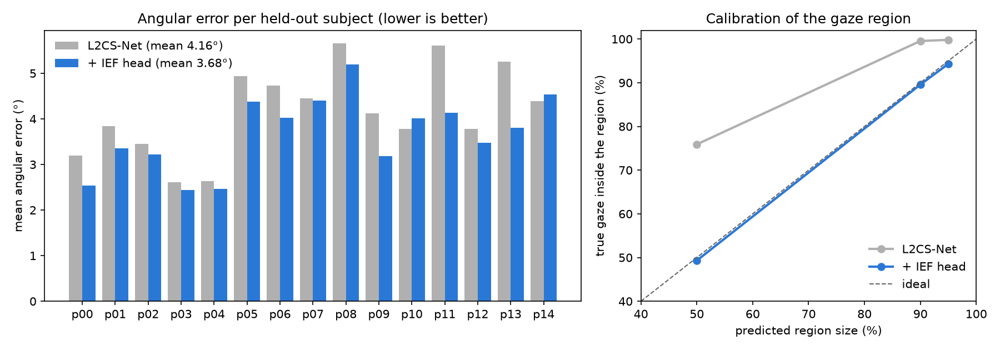
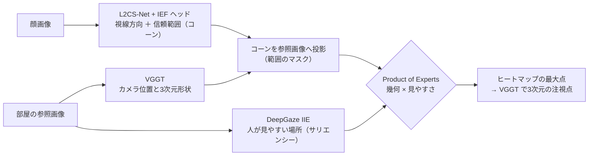

# gaze-ief-research

**顔画像と部屋の写真から、人が「どこを・どの物を見ているか」を“範囲”つきで推定し、見守りや支援を行うロボットが視線の先を見落とさずに探せるようにする研究パイプラインです。**

**視線推定の平均角度誤差 4.16° → 3.68°（−11.7%、15人中13人で改善）／「95%の範囲」に正解が入る割合 94.3%（理想 95%）**
<!-- TODO(Jason): シーン全体（視線の先の3D位置）での結果を、出典ログと一緒に追記（例：視線を範囲として扱うことでの誤差削減率） -->



| | |
|---|---|
| **課題** | 視線推定は「1本の方向」しか出さず、どれだけ確かか分からない。少しずれるだけで、部屋のどの物を見ているかを外してしまう |
| **工夫** | **他分野の手法を3つ借りた**：人の姿勢推定の Iterative Error Feedback（視線を少しずつ補正）、人が見やすい場所を予測する視覚サリエンシー（DeepGaze IIE）、3次元復元（VGGT）。これらを確率の積（Product of Experts）で統合 |
| **成果** | 視線推定は 15人の leave-one-subject-out で誤差 −11.7%、範囲の的中率がほぼ理想どおり（50%範囲 → 49.3%、95%範囲 → 94.3%）。シーン全体の評価パイプラインも実装済み |

---

## 視線を“範囲”として扱い、見やすさと3次元形状で絞り込む



- **範囲（コーン）**：視線を1本の線ではなく、確からしさに応じて広がる円錐として扱う。確信が高いときは細く、曖昧なときは太くなる。
- **統合**：「視線の範囲に入っているか」と「人が見やすい場所か」を掛け合わせ、両方を満たす場所を注視点とする。

## 視線の範囲推定は、15人の交差検証で誤差と“範囲の正しさ”を同時に改善した

MPIIFaceGaze、leave-one-subject-out（15 fold）。同じバックボーン・同じ28ビン設定・同じ評価コードで比較。

| | L2CS-Net（元） | + IEF ヘッド（本研究） |
|---|---|---|
| 平均角度誤差 | 4.164° | **3.677°** |
| 誤差が下がった被験者 | – | **13 / 15** |
| 50%範囲に正解が入る割合（理想 50%） | 75.9% | **49.3%** |
| 95%範囲に正解が入る割合（理想 95%） | 99.8% | **94.3%** |

元のモデルは範囲が広すぎ、何でも「入る」状態でした。IEF ヘッドは範囲を**必要な大きさまで絞り、しかも外さない**ようになりました。

出典：[`results/native_l2cs/eval_all_folds.txt`](results/native_l2cs/eval_all_folds.txt)、[`results/ief_mpiigaze_backbone/ief_mpiigaze_all_folds.txt`](results/ief_mpiigaze_backbone/ief_mpiigaze_all_folds.txt)。図は [`docs/make_figure.py`](docs/make_figure.py) で再生成できます。

**IEF（Iterative Error Feedback）とは**：一度で答えを出さず、今の推定を入力に戻して「上限つきの小さな修正」を3回くり返す方法（人の姿勢推定の手法を視線に応用）。誤差が下がるだけでは成功とせず、予測した範囲に正解が本当に入るか（被覆率）を必ず一緒に評価しています。

## 主な構成と技術

| 項目 | 内容 |
|---|---|
| 言語・ライブラリ | Python、PyTorch、torchvision、OpenCV、NumPy、SciPy、openpyxl |
| 視線推定 | L2CS-Net（ResNet-50）＋ IEF リファインメントヘッド（[`l2cs_net/l2cs/refinement_head.py`](l2cs_net/l2cs/refinement_head.py)） |
| シーン理解 | VGGT（3次元復元・カメラ姿勢）、DeepGaze IIE（サリエンシー） |
| パイプライン | [`final_form_ief.py`](final_form_ief.py)（IEF 各 fold ＋ アンサンブル）、[`final_form.py`](final_form.py)（元の L2CS-Net、複数のコーン設定） |
| 学習環境 | RTX 4060 Laptop（8 GB）— バックボーンを固定し、小さなヘッドだけを学習 |

### 実行方法

```bash
conda create -n vggt python=3.10 && conda activate vggt
pip install torch torchvision opencv-python numpy scipy pillow openpyxl
pip install -e l2cs_net/
# VGGT と DeepGaze IIE は各公式リポジトリの手順でインストール

# 視線推定（IEF ヘッド）の学習と評価：fold 0〜14
python l2cs_net/train_ief_mpiigaze.py --model_dir models/MPIIGaze --image_dir datasets/MPIIFaceGaze/Image \
    --label_dir datasets/MPIIFaceGaze/Label --output output/refinement_mpiigaze --fold 0
python l2cs_net/evaluate_ief_mpiigaze_all_folds.py --model_dir models/MPIIGaze --ckpt_dir output/refinement_mpiigaze \
    --image_dir datasets/MPIIFaceGaze/Image --label_dir datasets/MPIIFaceGaze/Label --output output/eval_ief_mpiigaze

# シーン全体のパイプライン（パスは環境変数で指定。.env.example を参照）
python final_form_ief.py
```

### データと学習済み重みは各自で入手する（ライセンス・個人情報のため同梱しない）

| もの | 入手先 |
|---|---|
| MPIIFaceGaze | Max Planck Institute for Informatics の公式ページ（研究目的の利用条件に従う） |
| L2CS-Net 学習済み重み（Gaze360 用、MPIIGaze 各 fold 用） | [L2CS-Net 公式リポジトリ](https://github.com/Ahmednull/L2CS-Net) |
| VGGT（`facebook/VGGT-1B`） | HuggingFace から自動ダウンロード |
| DeepGaze IIE | torch hub から自動ダウンロード |
| `centerbias_mit1003.npy` | [MIT1003](https://people.csail.mit.edu/tjudd/WherePeopleLook/) |
| シーン実験データ | 研究室で撮影した実験データ（被験者の顔を含むため非公開） |

データセット・重み・チェックポイント・顔画像は `.gitignore` で除外しています。

## 限界：確率の細かい較正（ECE）はまだ悪化している

- 範囲の被覆率は理想に近づいた一方、ビン単位の **ECE は 0.185 → 0.235 と悪化**。
- Gaze360 で学習したバックボーンの上に載せた版は 15 fold 平均 5.17° で、元の L2CS-Net（4.16°）より悪かった（[`results/ief_gaze360_backbone/`](results/ief_gaze360_backbone/)）。
- バックボーン全体を再学習した版は誤差 3.14° だが、95%範囲の的中率は 91.2% で過信気味。**6 fold（p00〜p05）しか実施していない**ため、15 fold の比較にはまだ使えない（[`results/finetune_gaze360/`](results/finetune_gaze360/)）。

## 今後：視線の範囲を使って、ロボットが見ている物を探す

- 能動カメラと組み合わせ、予測した範囲の中だけを探索して視線の先の物体を特定する。
- ECE も同時に改善する損失の検討。

## クレジット

- L2CS-Net（Abdelrahman et al.）のコードを基にしています（MIT License、[`l2cs_net/LICENSE`](l2cs_net/LICENSE)）。
- IEF の考え方：Carreira et al., "Human Pose Estimation with Iterative Error Feedback"（2016、arXiv:1507.06550）。
- VGGT（Meta）、DeepGaze IIE（Kümmerer et al.）はそれぞれのライセンスに従って利用しています。

<!-- TODO(Jason): 自分の追加コードのライセンスを決める（L2CS-Net と同じ MIT で良いか） -->

---

## English

**A research pipeline that estimates where a person is looking, and which object in the room, from a face image and photos of the room, together with a trustworthy *region*, so that care and assistive robots can search for what the person looks at without missing it.**

**Gaze error 4.16° → 3.68° (−11.7%, better for 13 of 15 people); the predicted 95% region contains the true gaze 94.3% of the time (ideal: 95%).**

| | |
|---|---|
| **Problem** | Gaze estimators output a single direction with no sense of certainty; a small error is enough to pick the wrong object in a room. |
| **Idea** | **Three methods borrowed from other fields:** Iterative Error Feedback from human pose estimation (corrects the gaze step by step), visual saliency from human-attention modelling (DeepGaze IIE), and 3D reconstruction (VGGT), combined as a Product of Experts. |
| **Result** | Gaze: −11.7% error in leave-one-subject-out on MPIIFaceGaze (15 folds), with almost perfectly calibrated regions (50% → 49.3%, 95% → 94.3%). The full scene pipeline is implemented. |

**How it works.** The gaze is treated as a cone whose width follows the model's certainty. The cone is projected into the reference views (camera poses from VGGT), multiplied with a saliency map (DeepGaze IIE), and the peak of the fused heatmap is lifted to a 3D point with VGGT (diagram above).

**Gaze results** (same backbone, same 28-bin setup, same evaluation code): error 4.164° → 3.677°; 50% region coverage 75.9% → 49.3%; 95% region coverage 99.8% → 94.3%. Sources in `results/`; the figure is rebuilt by `docs/make_figure.py`.

**Run.** See the commands above; paths are set with environment variables (`.env.example`). Datasets and weights are not included (licences and privacy): MPIIFaceGaze from the Max Planck Institute for Informatics, L2CS-Net weights from the [official repository](https://github.com/Ahmednull/L2CS-Net), VGGT and DeepGaze IIE download automatically. The scene recordings are private lab data.

**Limitations.** Bin-level ECE got worse (0.185 → 0.235). The variant on a Gaze360 backbone reached 5.17° (15 folds), worse than plain L2CS-Net. Fine-tuning the whole backbone reached 3.14° but became over-confident (95% region: 91.2%), and was run on 6 folds only.

**Next.** Let an active camera search only inside the predicted region to find the object the person is looking at.

**Credits.** Built on L2CS-Net (Abdelrahman et al., MIT License). IEF: Carreira et al., "Human Pose Estimation with Iterative Error Feedback" (2016, arXiv:1507.06550). VGGT (Meta) and DeepGaze IIE (Kümmerer et al.) are used under their own licences.
